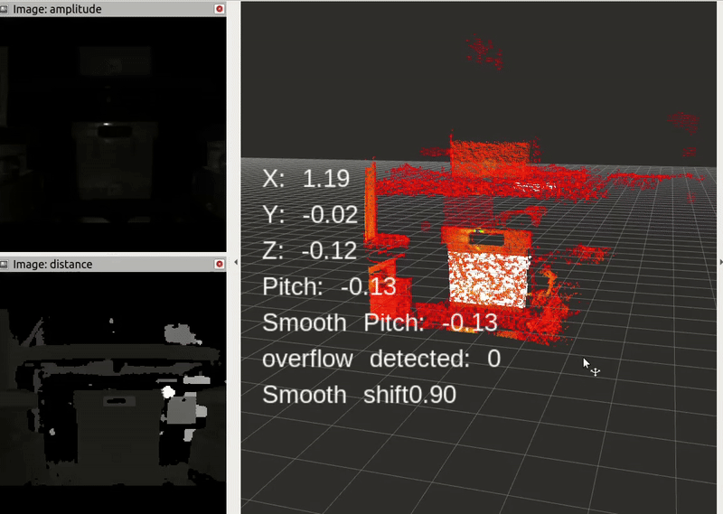
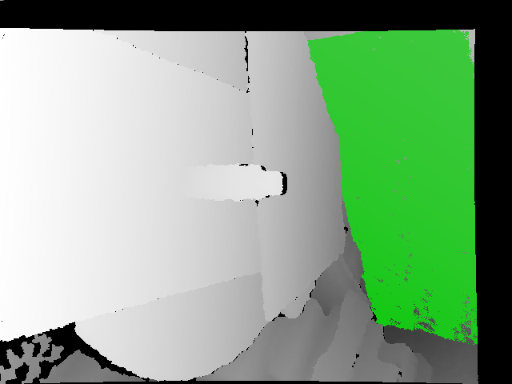
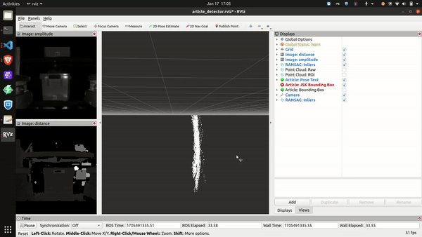
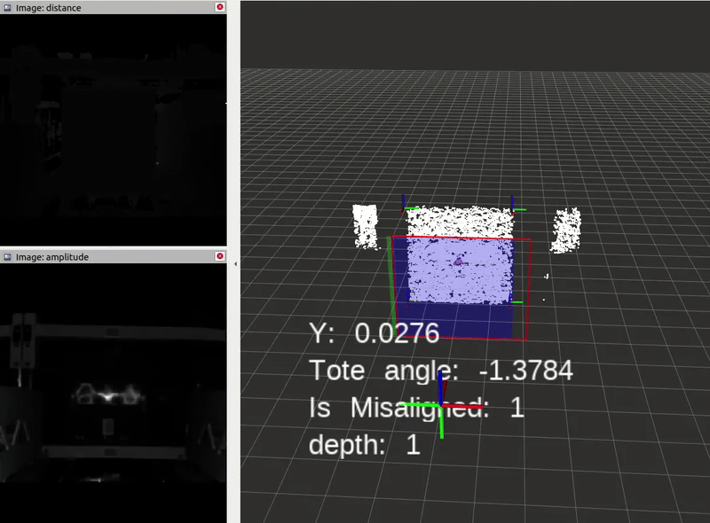
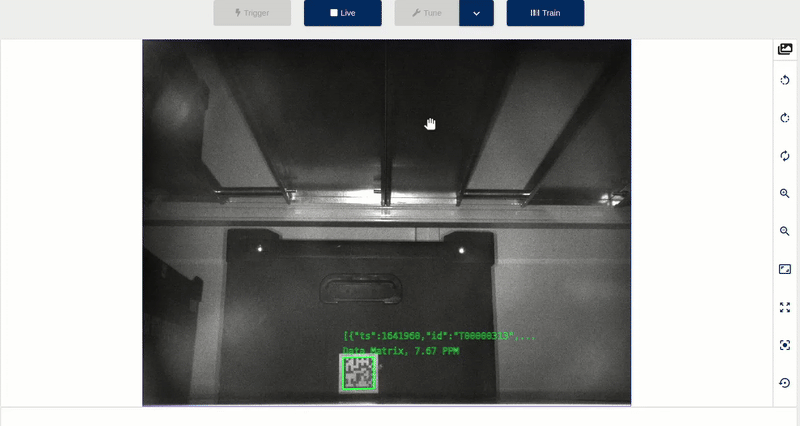

# plane_segmentation_tool

[](https://github.com/daatsi-aeres/plane_segmentation_tool/actions/workflows/ci.yml)

Robust 6-DoF pose of a planar face (a box top, a tote, a pallet layer) from a raw depth-camera point cloud, in C++17 and PCL.

This is the open-source version of the point cloud stage of the box-picking pose pipeline I built at Addverb Robotics. The write-up is on Medium: [Building a Robust Plane Segmentation Pipeline for 3D Pose Estimation in Robotics](https://medium.com/@siddharthramasushil/building-a-robust-plane-segmentation-pipeline-for-3d-pose-estimation-in-robotics-cb89243492fb).



## Why geometry instead of markers

The warehouse cells first located boxes from Data Matrix codes. In practice the codes were damaged, partly occluded, or offset from the box center because labels were placed by hand. Fiducials such as ArUco or AprilTags were ruled out because each one needs a person to place it. The box surface itself is always there, so the pose comes from the geometry of the face: its plane gives the normal, and its outline gives the center and the in-plane orientation.

## Pipeline


| Stage | Why it is there |
|---|---|
| ROI crop (optional) | Restricts work to the pick area; the largest speedup on full frames. |
| Voxel grid | Uniform density, so later neighborhood sizes mean the same thing everywhere. |
| Statistical outlier removal | Drops flying pixels at depth discontinuities, common on ToF sensors. |
| Coarse RANSAC (1 cm) | Finds the dominant plane hypothesis. An optional orientation prior rejects box sides. |
| Largest Euclidean cluster | A neighboring box at the same height lies in the same plane; only the connected patch is kept. |
| MLS smoothing | Removes sensor ripple so the refined normal is stable from frame to frame. |
| Fine RANSAC (4 mm) | Final plane on the smoothed patch. |
| Face inliers | MLS bends points near creases (where the top meets a side), so the face is measured on the original points within 4 mm of the refined plane. |
| Pose | Normal oriented toward the sensor; minimum-area enclosing rectangle (convex hull, exact over hull edges) for the long axis, with trimmed-quantile extents that ignore stray points. |

Output frame: `z` is the face normal toward the sensor, `x` is the long side of the face, `y = z × x`, and the origin is the center of the face rectangle. The tool also reports the face size and the RMS point-to-plane error.

## Results

### Accuracy on synthetic scenes with ground truth

`evaluate` renders a box as a depth sensor at the origin would see it: back faces are hidden, and the sample density falls with the viewing angle. It draws a random pose (tilt up to 40°, any yaw, 0.7 to 1.3 m away) and a random face size (25-50 cm by 15-25 cm) for each trial. The numbers below come from 300 trials per row with the orientation prior on (`--prior 1`) and default parameters.

| Noise σ / outliers | Normal error mean / p95 | Center error mean / p95 | Size error mean / p95 | Wrong plane |
|---|---|---|---|---|
| 0 mm / 0% | 0.15° / 0.46° | 1.7 mm / 4.0 mm | 5.4 mm / 10.6 mm | 0 / 300 |
| 2 mm / 5% | 0.14° / 0.36° | 0.5 mm / 1.0 mm | 7.1 mm / 8.7 mm | 0 / 300 |
| 4 mm / 15% | 0.18° / 0.40° | 1.0 mm / 2.0 mm | 10.0 mm / 12.8 mm | 0 / 300 |

Size error is the length error; width behaves the same way. Without the prior, 4 to 11 of 300 trials lock onto a box side at steep tilts. The other errors are unchanged.

### Runtime

Single thread, Release build, Intel Core i7-13650HX, from `benchmark`:

| Input | Points | Mean | p95 |
|---|---|---|---|
| Synthetic box scene | 56k | 21.5 ms | 21.8 ms |
| `data/sample.pcd`, full 640×480 frame, no ROI | 307k | 98 ms | 99 ms |

On a full frame most of the time goes to outlier removal and RANSAC over the whole scene. In use, the ROI crop limits the cloud to the pick area.

### Raw sensor frame

The dominant plane (green) found in `data/sample.pcd`, drawn over the depth image:



## Build

Ubuntu 22.04 with PCL 1.12 (any PCL from 1.10 should work):

```bash
sudo apt install build-essential cmake libpcl-dev libgtest-dev
cmake -S . -B build -DCMAKE_BUILD_TYPE=Release
cmake --build build -j
ctest --test-dir build --output-on-failure
```

`-DPLANE_SEG_WITH_VIEWER=OFF` drops the PCL visualization dependency (used for `--view`). `-DPLANE_SEG_BUILD_TESTS=OFF` skips the tests.

## Usage

```bash
./build/segment_plane data/sample.pcd --config config/default.yaml --output output/plane.pcd --view
```

```
loaded 307200 points from data/sample.pcd

stage                  points        ms
remove_nan             256665      1.51
voxel_grid              24521      7.58
outlier_removal         24453     36.16
ransac_coarse            8850     21.77
largest_cluster          8845     10.03
mls_smoothing            8845     19.64
ransac_fine              7120      1.09
face_inliers             6164      0.05
pose                     6164      0.60
total                             98.43

center [m]        0.5354 0.1056 1.4878
normal            -0.4059 0.6505 -0.6419
quaternion xyzw   0.6925 0.5843 0.0603 -0.4188
face extent [m]   1.3899 x 0.4328
plane RMS [mm]    2.14
```

Every parameter is in [`config/default.yaml`](config/default.yaml). Set `expected_normal_*` to the camera axis for top-down picking, and `roi_min_*` / `roi_max_*` to the pick area.

As a library:

```cpp
#include "plane_seg/plane_segmenter.hpp"

plane_seg::Params params;
params.expected_normal = Eigen::Vector3f::UnitZ();  // top-down camera
plane_seg::PlaneSegmenter segmenter(params);

const plane_seg::Result r = segmenter.segment(cloud);  // pcl::PointCloud<pcl::PointXYZ>::ConstPtr
if (r.success) {
  const Eigen::Isometry3f T_cam_face = r.pose.transform;
  const Eigen::Vector2f size = r.pose.extent;  // length, width [m]
}
```

Evaluation and benchmarking:

```bash
./build/evaluate --trials 300 --noise 0.002 --outliers 0.05 --prior 1
./build/benchmark data/sample.pcd --runs 30
```

## Repository layout

```
include/plane_seg/   public headers (segmenter, pose, config, synthetic scenes)
src/                 implementation
apps/                segment_plane, benchmark, evaluate
tests/               GoogleTest unit tests (run in CI)
config/              default parameters
data/                sample depth frame
```

## From the production system

These frames come from the deployed pipeline at Addverb Robotics, viewed in RViz with the ToF amplitude and distance images on the left.

| | |
|---|---|
|  |  |
| Raw ToF point cloud | Largest planar cluster |
|  |  |
| Smoothed plane | A damaged Data Matrix tag, the reason for this work |

## Limitations

- The tool returns one face per call: the dominant plane in the ROI.
- It assumes a roughly rectangular face. Extents are biased by about one voxel (1 cm by default) under sensor noise.
- Without an orientation prior, a box side can win at steep tilts (see the table above).

## Roadmap

- ROS 2 node that publishes `geometry_msgs/PoseStamped` and RViz markers, with parameters exposed as ROS parameters.
- Multiple faces per frame by iterative extraction, for picking from a full layer.
- Fast path for organized clouds (integral-image normals and organized multi-plane segmentation) to cut full-frame latency.
- Temporal filtering of the face pose on SE(3) across frames.
- Evaluation on recorded real data with ground-truth poses.
- Python bindings (pybind11).

## License

MIT, see [LICENSE](LICENSE).
